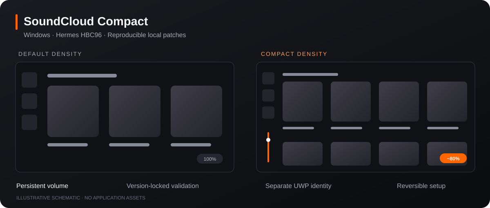

# SoundCloud Compact for Windows

**A reproducible, version-locked patcher for a denser SoundCloud desktop interface.**

Built for a real daily-use problem: fitting more music into the window and keeping volume controls accessible while playing games.

[Русская версия](docs/README.ru.md) · [How it works](docs/TECHNICAL.md) · [Validation & measurements](docs/VALIDATION.md)



*Illustrative schematic, drawn for this repository. It contains no SoundCloud assets or account data.*

## What it does

| Change | Behaviour |
| --- | --- |
| Compact layout | Approximately 80% of the original dimensions for values using the shared sizing utility |
| Player volume | Horizontal volume slider stays visible without hovering |
| Sidebar volume | A vertical slider shares the same volume state as the player |
| Less decorative work | Static equalizer and no slider fade/slide animation |
| Smaller inactive query cache | Default retention changes from five minutes to one minute |
| Optional diagnostics removed | Sentry initialization is disabled |
| Game-friendly launch | The launcher sets the local process to BelowNormal and exits |

The patcher operates on a local copy of the installed package. It keeps the original Store installation, ownership and permissions intact. The local copy has its own package identity and app storage.

## Compatibility

**Only this exact build is supported:**

| Component | Tested value |
| --- | --- |
| Package | `SoundcloudLtd.SoundCloud-MusicAudio` |
| Version / architecture | `2.12.4.0 / x64` |
| UI runtime | React Native Windows + Hermes |
| Bytecode | HBC96 |
| Source bundle length | 2,955,088 bytes |
| Python | 3.12 |
| OS tested | Windows 11 25H2 |
| Local package identity | `SoundClaude.Compact80` |

Both the source and resulting bundle are checked against known SHA-256 hashes. Other versions, altered inputs and optimized Python execution (`-O`) are rejected.

**This repository does not distribute SoundCloud, its bundle, DLLs, assets, user data or a prebuilt modified app.** You must already have the supported Store build. If yours has updated, this patcher will stop; a new build needs a separate investigation.

## Quick start

Requirements: Windows, Python 3.12, Git, the supported installed SoundCloud build, and Windows Developer Mode for local unsigned package registration.

Run from a normal PowerShell window in the cloned project:

```powershell
git clone https://github.com/AZAZAouh/soundcloud-compact-windows.git
cd soundcloud-compact-windows

# Downloads the pinned, open-source bytecode tooling.
.\Setup-Tools.ps1

# Reads the installed package and creates an untouched local snapshot.
.\Copy-InstalledPackage.ps1

# Builds compact-80 inside this project.
python tools/prepare_compact.py

# Registers a separate local UWP package and launches it.
.\Register-Compact.ps1
```

Enable **Developer Mode** manually in Windows Settings before registration. Error `0x80073CFF` means local development deployment is not permitted. The scripts do not change this setting, ACLs, package ownership or certificate trust.

If reading the package is denied, stop and inspect permissions; these scripts do not take ownership of WindowsApps.

Sign in to **SoundCloud Compact 80 (local)** using its activation screen. Its login is separate from the Store app.

For subsequent launches:

```powershell
.\Launch-Compact.ps1
```

Keep the project directory in place while the local package is registered. Launch through its package identity, not by double-clicking the copied executable. Close the local app before rebuilding it.

### Rollback

**Return to the original 80% layout patch, keeping the same local registration and account storage:**

```powershell
# Close SoundCloud Compact first.
python tools/prepare_compact.py --baseline
.\Launch-Compact.ps1
```

Reapply all changes with `python tools/prepare_compact.py` after closing the app.

**Remove the separate local app:**

```powershell
.\Rollback-Compact.ps1
```

Removal deletes that local package's app data. The original Store package remains installed.

## How it works

The UI bundle is compiled Hermes bytecode rather than editable JavaScript. The investigation identified a shared sizing utility using a design reference of `940 × 540`.

Changing that reference to `1175 × 675` increases its diagonal by 1.25×:

```text
original: round(value × windowDiagonal / designDiagonal)
patched:  round(value × windowDiagonal / (1.25 × designDiagonal))
```

The result is approximately `0.8 ×` the original size, subject to rounding. This affects dimensions routed through that utility; it is not a universal OS zoom setting.

Additional instruction patches keep volume visible, reuse the existing volume component in the sidebar, and remove specific background/decorative work. The sidebar function is relocated while preserving its function ID. File length, function metadata and the Hermes SHA-1 footer are updated.

See [the technical notes](docs/TECHNICAL.md) for patch points and integrity checks.

## Performance: measured, not promised

One **15.013-second** sample during minimized playback on an **8-logical-processor** machine recorded:

| Metric | Observation |
| --- | ---: |
| Process CPU time | 0.390625 s |
| Average total CPU utilization | ~0.33% |
| Working set | 199.2 MiB |
| Private commit | 251.7 MiB |

These are observations from one machine, not guaranteed limits or proof of an improvement over the baseline. Valorant FPS was not measured.

A substantial RAM reduction was **not demonstrated**. Idle working sets were similar, around 202–204 MiB. The always-mounted volume UI also showed higher idle CPU in one visible-window comparison. Minimize the window during games. The lower process priority affects scheduling, not the amount of work or memory allocated.

See [validation notes](docs/VALIDATION.md) for comparisons and limitations.

## Checks

```powershell
python -m unittest discover -s tests -v
```

Four source-only tests check rejection of unsupported or corrupted inputs. A fifth test checks exact output hashes and integrity when the supported local bundle is available. CI does not contain or download the proprietary bundle, so that integration test is skipped there.

Manual validation covered navigation, track playback, both sliders, dragging and synchronization between screens. The modified bundle was fully disassembled again. All 77 copied original files matched the installed package during the investigation.

## Project structure

```text
tools/prepare_compact.py       validation, layout patch and local copy preparation
tools/patch_player.py          targeted HBC96 instruction patches
Copy-InstalledPackage.ps1      read-only snapshot of the installed package
Setup-Tools.ps1                pinned hermes-dec dependency
Register-Compact.ps1           separate UWP registration
Launch-Compact.ps1             package launch + bounded priority adjustment
Rollback-Compact.ps1           remove only the local package
tests/                        guards and local reproducibility check
docs/                         design, measurements and Russian instructions
```

`original/`, `compact-80/`, downloaded tooling, disassemblies and local analysis files are ignored by Git.

## Scope and credits

An unofficial personal engineering project, unaffiliated with SoundCloud. No authentication, subscription or access-control bypass is implemented.

Developed with **OpenAI Codex assistance**, driven by a real user requirement and verified on the local application. AI assistance is part of the workflow; the repository documents what was actually tested and what remains uncertain.

Bytecode parsing and instruction definitions come from [P1sec/hermes-dec](https://github.com/P1sec/hermes-dec), pinned to `2e796663e1fedb93dca51060797ebf3327b3fedb`. Its authors and license are credited in [third-party notices](THIRD_PARTY_NOTICES.md).

The patch scripts and documentation are published under **AGPL-3.0-or-later**. SoundCloud's application, branding and assets are outside this repository's license.
